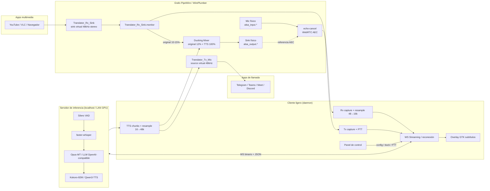

# SYSTEM ARCHITECTURE & DESIGN SYSTEM BLUEPRINT

- **Project Name:** BabelPipe — Traducción Simultánea Universal sobre PipeWire
- **Architecture Status:** `LOCKED` (pendiente de aprobación humana — ZERO-CODE GATE activo)
- **Primary Runtime & Stack:** Python 3.12 vía `uv` + PipeWire/WirePlumber + WebSocket binario + faster-whisper/CTranslate2 + Kokoro-82M + GTK4 (PyGObject) / AppImage-Flatpak
- **Last Updated By:** `@architect`

---

## 1. TECH STACK & PINNED DEPENDENCIES

| Layer | Technology / Package | Version | Purpose & Architectural Justification |
| :--- | :--- | :--- | :--- |
| **Runtime / Entorno** | Python + `uv` | `3.12` / `^0.5` | Aislamiento PEP 668 en Kali; prohibido `pip` global |
| **Audio (sistema)** | PipeWire + WirePlumber + `libpipewire-module-echo-cancel` | `>=1.0` | Grafo de audio en espacio de usuario, sin kernel drivers |
| **Audio (Python)** | `soxr`, `numpy`, `soundfile` | `^0.5` / `^2.0` / `^0.12` | Resampleo 48↔16 kHz de alta calidad y fixtures PCM |
| **Transporte** | `websockets`, `pydantic` | `^13` / `^2.9` | WS binario + validación estricta de JSON de control |
| **VAD** | `silero-vad` (MIT) | `^5.1` | Segmentación por pausas; prohibidas ventanas ciegas |
| **STT** | `faster-whisper` (MIT) / `whisper.cpp` (MIT) | `^1.1` | Transcripción incremental, int8/CT2 |
| **Traducción** | `ctranslate2` + modelos Opus-MT (CC-BY-4.0); `openai` (MIT) | `^4.5` / `^1.5` | Adaptador NMT local y endpoint LLM compatible OpenAI |
| **TTS** | `kokoro` (Apache-2.0) / Qwen3-TTS (Apache-2.0) + `misaki` (MIT) | `^0.9` | Salida en streaming por chunks; G2P sin espeak-ng (GPL) |
| **UI Cliente** | GTK 4 toolkit + PyGObject + CSS tokens | GTK `>=4.14` / PyGObject `>=3.50,<4` | Overlay siempre visible + panel de control ligero (PyGObject se versiona 3.x en PyPI; GTK 4 es el toolkit) |
| **Testing & QA** | `pytest`, `pytest-asyncio`, `ruff`, `mypy`, `pip-audit` | `^8.3` / `^0.24` / `^0.7` / `^1.11` | Tests sin hardware, typecheck, linter, auditoría de deps |
| **Empaquetado** | `python-builder` (AppImage) / `flatpak-builder` | — | Artefacto verificable en Fase 5 |

---

## 2. DIRECTORY & MODULE TOPOLOGY

> **Regla para `@builder`:** Prohibido crear archivos fuera de esta estructura sin actualizar primero este árbol.

### 2.1 PipeWire Graph (Rx + Tx + Ducking + AEC)



**Notas del grafo:**
- El `.monitor` de `Translator_Rx_Sink` se captura **dos veces**: una para el pipeline de traducción y otra para el mezclador de ducking (señal original atenuada).
- El AEC usa `libpipewire-module-echo-cancel` con `aec_args`: `analog_gain_control=0 digital_gain_control=0 noise_suppression=1` y como referencia el monitor del sink físico, evitando que la voz del interlocutor se reenvíe por Tx.
- El `Translator_Tx_Mic` es un `null-sink`-style source (`module-null-sink` + `module-remap-source` o `module-pipe-source`) expuesto con nombre estable. El sink maestro auxiliar se denomina internamente `Translator_Tx_Master` y solo aparece como nodo de apoyo en `pw-dump`; no cuenta como bus lógico adicional.
- Apagado: `trap` en `scripts/setup-nodes.sh` y manejador de señales en `client/main.py` descargan todos los módulos creados por la sesión.

### 2.2 Árbol de directorios definitivo

```text
.
├── .factory/                       # Contratos persistentes (SPEC / ARCH / TASKS / SECURITY_AUDIT)
├── README.md
├── pyproject.toml                  # Workspace uv, dependencias fijadas, scripts
├── uv.lock
├── .env.example
├── config.toml.example
├── NOTICE                          # Atribución CC-BY-4.0 (Opus-MT) y Apache-2.0
├── scripts/
│   ├── check-pipewire.sh           # pactl info / pw-cli / pw-dump + WirePlumber
│   ├── setup-nodes.sh              # crear/limpiar Rx, Tx, AEC (idempotente)
│   ├── generate-fixtures.py        # WAV sintéticos 48k/16k, tono, voz, ruido, eco
│   └── package.sh                  # AppImage / Flatpak (--check)
├── shared/                         # Contrato canónico — ÚNICA fuente del protocolo
│   ├── __init__.py
│   ├── constants.py                # SAMPLE_RATE=16000, CHUNK_MS=20, CHUNK_SAMPLES=320
│   ├── protocol.py                 # encode/decode cabecera binaria 16 bytes
│   └── models.py                   # Pydantic: Config, Subtitle, Duck, Ptt, Error, Reconnect
├── client/                         # Proceso 1: daemon de ruteo + overlay + UI
│   ├── __init__.py
│   ├── main.py                     # CLI: --setup/--run/--teardown + modo vídeo (TASK-017)
│   ├── call_mode.py                # orquestación de llamada bidireccional Rx+Tx (TASK-020)
│   ├── config.py                   # carga .env/config.toml, validación Pydantic
│   ├── state.py                    # estado de sesión y persistencia
│   ├── audio/
│   │   ├── __init__.py
│   │   ├── transport.py            # ABC AudioTransport + implementación Mock
│   │   ├── pipewire_graph.py       # pactl/pw-cli load/unload idempotente
│   │   ├── resampler.py            # soxr 48↔16 kHz
│   │   ├── ducking.py              # mezclador con duck_level configurable
│   │   ├── ptt.py                  # Push-to-Talk (flags + atajo global)
│   │   └── echo_cancel.py          # configuración del módulo AEC
│   ├── net/
│   │   ├── __init__.py
│   │   ├── messages.py             # reexport de shared.models
│   │   ├── ws_client.py            # async WS, backoff, resume por session_id/last_seq
│   │   └── stream.py               # productor/consumidor con asyncio.Queue
│   ├── overlay/
│   │   ├── __init__.py
│   │   └── subtitle_window.py      # GTK4 always-on-top, semitransparente
│   └── ui/
│       ├── __init__.py
│       ├── control_panel.py        # selector app, idiomas Rx/Tx, duck, PTT
│       └── theme.css               # design tokens (§5)
├── server/                         # Proceso 2: inferencia desacoplada
│   ├── __init__.py
│   ├── main.py                     # arranque WS + /healthz
│   ├── config.py                   # .env / config.toml (host, puerto, token, modelos)
│   ├── health.py
│   ├── protocol.py                 # reexport de shared.protocol
│   └── pipeline/
│       ├── __init__.py
│       ├── base.py                 # ABC VAD / STT / Translator / TTS
│       ├── vad.py                  # Silero VAD
│       ├── stt.py                  # faster-whisper / whisper.cpp
│       ├── translator.py           # Opus-MT CT2 + adaptador LLM OpenAI
│       ├── tts.py                  # Kokoro-82M / Qwen3-TTS streaming
│       ├── mock.py                 # implementaciones deterministas para tests
│       └── orchestrator.py         # una tarea asyncio por sesión + colas + métricas
└── tests/
    ├── conftest.py                 # opciones pytest compartidas (--mock) y generación de fixtures
    ├── fixtures/                   # WAV generados por scripts/generate-fixtures.py
    ├── unit/                       # protocolo, resampleo, VAD, PTT, config, overlay
    ├── integration/                # grafo (mock), WS server/client, ducking, AEC, latencia
    └── e2e/                        # test_video_mode.py, test_call_mode.py, test_bidirectional.py
```

---

## 3. DATA LAYER & SCHEMA CONTRACTS

> No hay base de datos: la "capa de datos" son los esquemas de configuración y los eventos de sesión, todos validados con Pydantic v2.

### Entity: AppConfig (`config.toml` + `.env`)

| Column | Type | Constraints | Security / Notes |
| :--- | :--- | :--- | :--- |
| `server.host` | IPv4Address / str | DEFAULT `127.0.0.1` | En LAN exigir `token` y preferir `wss://` |
| `server.port` | int (1024-65535) | DEFAULT `8765` | Sin exponer sin token |
| `server.token` | SecretStr | REQUIRED si host ≠ localhost | Nunca en repo; `.env` en `.gitignore` |
| `audio.rx_sink` | str | DEFAULT `Translator_Rx_Sink` | Nombre estable del nodo |
| `audio.tx_source` | str | DEFAULT `Translator_Tx_Mic` | Nombre estable del nodo |
| `audio.duck_level` | float (0.10-0.15) | DEFAULT `0.12` | Rango legal por SPEC §REQ-05 |
| `audio.echo_cancel` | bool | DEFAULT `true` | WebRTC AEC |
| `audio.ptt_enabled` | bool | DEFAULT `false` | Push-to-Talk opcional |
| `pipeline.source_lang` / `target_lang` | str (ISO 639-1) | REQUIRED | Rx y Tx independientes |
| `pipeline.stt` / `translator` / `tts` | Enum | DEFAULT `faster-whisper`/`opus-mt`/`kokoro` | Intercambiables por interfaz |

### Entity: SubtitleEvent (`shared.models`)

| Column | Type | Constraints | Security / Notes |
| :--- | :--- | :--- | :--- |
| `session_id` | UUID4 | REQUIRED | Correlaciona stream y reanudación |
| `stream` | Enum(`rx`,`tx`) | REQUIRED | Distingue doblaje de micrófono |
| `text` | str (max 2000) | REQUIRED | Escapado en GTK (nunca markup sin sanitizar) |
| `is_final` | bool | REQUIRED | Parcial vs. cláusula cerrada por VAD |
| `latency_ms` | int (0-5000) | OPTIONAL | Métrica de AC-07 |

---

## 4. API & SERVER CONTRACTS

### 4.1 WebSocket endpoint

`ws(s)://{host}:{port}/ws/translate?token={bearer}` — un único socket para audio y control.

### 4.2 Cabecera de frame binario PCM (16 bytes, `!2sBBHIIH`)

| Offset | Size | Type | Field | Descripción |
| :--- | :--- | :--- | :--- | :--- |
| 0 | 2 | `char[2]` | `magic` | Constante `b'BP'` |
| 2 | 1 | `uint8` | `version` | `0x01` |
| 3 | 1 | `uint8` | `flags` | bit0 `FINAL`, bit1 `DUCK_START`, bit2 `DUCK_STOP`, bit3 `PTT_ACTIVE` |
| 4 | 2 | `uint16` | `stream_id` | `1` = Rx, `2` = Tx |
| 6 | 4 | `uint32` | `sequence` | Monótono por stream; base de reanudación |
| 10 | 4 | `uint32` | `sample_rate` | `16000` (estricto) |
| 14 | 2 | `uint16` | `num_samples` | `320` para 20 ms |
| 16 | N | `bytes` | `pcm` | `num_samples * 2` bytes, int16 LE mono |

### 4.3 Eventos JSON (text frames)

| Dirección | `type` | Payload | Propósito |
| :--- | :--- | :--- | :--- |
| C→S | `config` | `{session_id, mode:"rx"\|"tx", source_lang, target_lang, vad, stt, translator, tts, audio_config}` | Negociar pipeline |
| C→S | `audio_config` | `{sample_rate:16000, channels:1, format:"pcm_s16le", chunk_ms:20}` | Bloquear formato |
| C→S | `ptt` | `{active:bool}` | Push-to-Talk |
| C→S | `reset` | `{session_id}` | Reiniciar segmentación |
| C→S | `ping` | `{ts}` | Keepalive / RTT |
| S→C | `ready` | `{models:[...], session_id}` | Pipeline listo |
| S→C | `subtitle` | `{session_id, stream, text, is_final, latency_ms}` | Subtítulo parcial/final |
| S→C | `translated` | `{text, is_final, lang}` | Texto traducido confirmado |
| S→C | `duck` | `{action:"start"\|"stop", stream:"rx"}` | Señalización de ducking |
| S→C | `tts_chunk` | `{seq, duration_ms}` | El audio va en frame binario; esto lo anuncia |
| S→C | `reconnect` | `{retry_after_ms, session_id, last_seq}` | Backoff / reanudación |
| S→C | `error` | `{code, message}` (sin stack trace) | `SCHEMA`, `AUTH_FAILED`, `FORMAT`, `MODEL_ERROR` |
| S→C | `pong` | `{ts}` | Respuesta a ping |

> **ADR-006:** Las condiciones no fatales de SPEC §5 (`OVERRUN`, `DUPLICATE`, `ECHO_DETECTED`) se transmiten como eventos `error` con código no fatal y la conexión permanece abierta. No se introduce un tipo `warning` separado para mantener `shared.models` cerrado y estable.

### 4.4 Reconexión y backpressure

- El cliente reintenta con backoff exponencial `250ms, 500ms, 1s, 2s, 4s, 8s` + jitter.
- Reanudación: envía `config` con `session_id` y `last_seq`; el servidor descarta `sequence <= last_seq` (deduplicación) y reanuda el estado VAD.
- Colas `asyncio.Queue(maxsize=50)` en cliente y servidor; si se llena, se descartan chunks antiguos y se emite `warning OVERRUN` (nunca bloquear el hilo de captura).

---

## 5. UI DESIGN SYSTEM (`@ui-artisan` CONTRACT)

- **Aesthetic Personality:** HUD de estudio — precisión técnica, alto contraste, superficies en capas sutiles, overlay periférico que no estorbe.
- **Color Tokens (`client/ui/theme.css`):**
  - `--bg-canvas: #0B0F14` | `--bg-surface: #151B23` | `--bg-elevated: #1E2733`
  - `--border-subtle: #2A3543` | `--border-strong: #3D4B5C`
  - `--text-primary: #E6EDF3` | `--text-secondary: #B7C2D0` | `--text-muted: #8B98A8`
  - `--accent-primary: #22D3EE` | `--accent-foreground: #04212B` | `--accent-hover: #67E8F9`
  - `--status-success: #34D399` | `--status-warning: #FBBF24` | `--status-danger: #F87171`
  - `--overlay-bg: rgba(11,15,20,0.62)` | `--overlay-blur: 8px`
- **Typography & Rhythm:**
  - Sans: `Inter` | Mono: `JetBrains Mono` (métricas de latencia y códigos de error).
  - Escala espacial estricta: múltiplos de 4 px (`4, 8, 12, 16, 24, 32`).
  - Radios: `--radius-sm: 6px`, `--radius-md: 10px`, `--radius-lg: 14px`.
- **Mandatory Component Standards:**
  - Overlay: always-on-top, semitransparente, redimensionable, sin capturar clicks excepto en el botón de cierre.
  - Panel: selectors con validación inline, botón de apply deshabilitado durante `aria-busy`, estados `Listening/Empty/Error` con `Retry`.

---

## 6. SECURITY & INFRASTRUCTURE HARDENING

- **Autenticación:** token Bearer en el handshake WS; `wss://` obligatorio si `host != 127.0.0.1`. Sin token → cierre `1008`.
- **Frontera de entrada:** todo JSON de control pasa por Pydantic v2; frames binarios validan magic, versión, `sample_rate==16000` y `len(pcm)==num_samples*2`.
- **WS Hardening:** `max_size` de frame, rate limiting por `session_id`, sin exposición de stack traces, logging estructurado sin PII.
- **Secretos:** `.env` en `.gitignore`; `.env.example` sin valores reales; `SecretStr` en Pydantic.
- **Dependencias:** `uv.lock` fijado, `pip-audit` en CI, escaneo de licencias (SPEC §6). Prohibido `eval`, `exec` con input externo y rutas sin sanitizar en `scripts/`.
- **Aislamiento:** el servidor de inferencia puede correr en contenedor Docker/Podman en la LAN; el cliente solo necesita permisos de usuario para PipeWire.

---

## 7. ARCHITECTURAL DECISION RECORDS (ADR) & CIRCUIT BREAKER LOG

> `@architect` registra aquí cualquier cambio estructural motivado por un bloqueo de 3 fallos consecutivos en `TASKS.md`.

- **ADR-001:** Separación estricta en dos procesos (cliente ligero + servidor de inferencia) mediante WebSocket binario, para permitir GPU remota en LAN y mantener el daemon de escritorio libre de dependencias pesadas. Motivo: latencia y portabilidad.
- **ADR-002:** Ducking implementado en el mezclador de software del cliente (no en WirePlumber) para que sea determinista y testeable con fixtures WAV sin hardware. Rango 0.10-0.15.
- **ADR-003:** **NLLB-200 queda EXCLUIDO** pese a mencionarse en el enunciado: su licencia CC-BY-NC-4.0 viola la restricción comercial. Se usa Opus-MT (CC-BY-4.0, con `NOTICE`) y LLM local Apache-2.0/MIT.
- **ADR-004:** G2P con `misaki` (MIT) en lugar de `espeak-ng`/`phonemizer` (GPL-3.0), para no introducir copyleft viral vía Kokoro.
- **ADR-005:** Formato canónico `pcm_s16le` 16 kHz mono en 20 ms (320 samples). El contrato vive en `shared/` y es reexportado por cliente y servidor para evitar divergencia de protocolo.
- **ADR-006:** Eventos no fatales (`OVERRUN`, `DUPLICATE`, `ECHO_DETECTED`) usan `error` con código no fatal y socket abierto, en lugar de añadir un tipo `warning` al contrato cerrado de `shared.models`.
